# Using Eclipse with RISC OS sources

This guide takes you from nothing to browsing and editing a RISC OS source
tree in Eclipse. It assumes you have never used Eclipse before.

What you get:

* **ARM assembler** (objasm): colouring; grey shading of code a configuration
  doesn't assemble; hover showing what a symbol is, what a macro call expands
  to and what a `$variable` line becomes; go to definition and find uses
  across the whole tree; outline, folding and completion.
* **BBC BASIC**, text or tokenised (`,ffb`): colouring; go to a PROC or FN and
  find its uses; variables' declarations and assignments; outline, folding
  and completion. Tokenised programs are edited as text and saved tokenised.
* **Messages files**: colouring of tokens and comments, and NUL characters
  that can be edited and saved safely.
* **CMHG** (module header) files: colouring.
* **C and C++** through Eclipse's own C tools (CDT), with each file's include
  paths and macros taken from the makefiles, and links between C and
  assembler.

The screenshots are of a small made-up tree, taken in the plugin's own tests
on Linux. Throughout, keys are given for Linux and Windows. On macOS use ⌘ for Ctrl.
In commands and paths, the parts written `<like this>` are yours to fill in.

## 1. What you need

* **A RISC OS source tree that has been built**. The easiest to get is a
  package tree: on ROOL's GitLab, open one of the products under
  [Products](https://gitlab.riscosopen.org/Products), go to its CI
  pipelines, and download the artifacts (`artifacts.zip`) of a
  `latest_package_tree` job. Unpack it somewhere (on Windows, see
  [below](#on-windows): Explorer can't do it). A tree you have
  cross-built yourself works just as well. Either way, the build has
  exported the headers (`RiscOS/Export/…`) that the assembler sources `GET`,
  and made the `objs/` directories of links to each component's sources,
  which are the names everything here works with. A tree that has never been
  built can be imported, but much less of it can be indexed.
* **The tree's path must have no spaces in it.** `make` can't cope with them,
  and the import refuses such a tree. Move or unpack the tree somewhere else
  if need be.
* **`bash` and GNU `make` 4.0 or later.** The import runs the makefiles in
  "dry run" mode (`make -n`) to find out how each file is assembled or
  compiled; nothing is built, so the RISC OS compilers and tools aren't
  needed. Linux has both, as `bash` and `make` on the `PATH`. On macOS, the
  `make` Apple supplies is too old: see [below](#on-macos). On Windows they
  come from MSYS2: see [below](#on-windows).
* **A computer with a few gigabytes of memory to spare.** The indexer uses up
  to 1.5 GB of its own, besides Eclipse.

This has been used on Linux, Windows and macOS.

### On macOS

1. **Install GNU make** with [Homebrew](https://brew.sh/):
   ```
   brew install make
   ```
   This installs it as `gmake`, beside Apple's `make`, which is too old.
   Nothing more is needed: the plugin finds `gmake` in Homebrew's directory
   even when Eclipse is started from the Dock, whose `PATH` doesn't include
   it, and makes sure the makefiles' own calls of `make` reach it too.
   (Apple's `bash` is old, but it will do.) If your GNU make is somewhere
   else, set the environment variable `RISCOS_MAKE` to its full name.
2. **Unpack the tree with `unzip`** in Terminal, which keeps the links:
   ```
   mkdir ~/riscos
   cd ~/riscos
   unzip ~/Downloads/artifacts.zip
   ```
   This gives you `~/riscos/RiscOS`, the directory to import.

Eclipse for macOS comes as a `.dmg`: open it and drag **Eclipse** to
**Applications**. Choose the download for your Mac's processor (**AArch64**
for Apple silicon, **x86_64** for Intel).

### On Windows

Windows needs three things doing before you start.

1. **Install MSYS2**, which provides `bash` and `make`, from
   <https://www.msys2.org/>, in its usual place, `C:\msys64`. Then open
   **MSYS2 MSYS** from the Start menu and type
   ```
   pacman -S make
   ```
   Nothing needs adding to the `PATH`: the plugin finds MSYS2 in
   `C:\msys64` itself. (If you installed it elsewhere, set the environment
   variable `RISCOS_BASH` to the full name of its `usr\bin\bash.exe`.)
   The `bash` that comes with Git for Windows won't do on its own, as it has
   no `make`.
2. **Turn on Developer Mode** (**Settings › System › For developers**). The
   `objs/` directories are full of symbolic links, and Windows only lets
   programs make those in Developer Mode (or when run as administrator).
3. **Unpack the tree with `tar`**, which comes with Windows, rather than
   Explorer's **Extract All**, which doesn't make the links (and PowerShell's
   `Expand-Archive` gives up at the first name Windows can't have). In a
   Command Prompt:
   ```
   mkdir C:\riscos
   tar -xf %USERPROFILE%\Downloads\artifacts.zip -C C:\riscos
   ```
   This gives you `C:\riscos\RiscOS`, the directory to import. Choose a
   directory whose path has no spaces: not one under your user directory if
   your user name has a space in it. If a build product's name has a
   character Windows doesn't allow, such as `:`, `tar` leaves it out; build
   products aren't needed here.

Importing takes longer than on Linux, because running `make` is slower under
MSYS2: several minutes for a whole tree.

**Line ends.** A tree unpacked from a package tree has LF line ends, as RISC
OS sources do. One checked out with git on Windows, where git is usually set
to convert them (`core.autocrlf`), has CR LF instead. Either works: the Env
files are read ignoring the CRs, and the editors keep each file's own line
ends. Git leaves tokenised BASIC alone, since it can tell such files aren't
text. New files you create get Eclipse's usual line ends, CR LF on
Windows, which git converts to LF when you commit them.

## 2. Installing Eclipse

1. Go to <https://www.eclipse.org/downloads/packages/>. Don't use the big
   "Download" button at the top of the page, which fetches the Eclipse
   *Installer*: scroll down the list of packages to **Eclipse IDE for C/C++
   Developers** and pick the download for your system.
2. Unpack it wherever you like (for example in your home directory) and run
   `eclipse` (`eclipse.exe` on Windows) in the directory it unpacks to. It
   includes its own Java, so you don't need to install one.
3. Eclipse asks for a **workspace**: a directory where it keeps its settings
   and the indexes. Choose a new, empty one, such as
   `<home>/eclipse-workspace`. It doesn't need to be near the source tree, and
   the tree is *not* copied into it.
4. Close the Welcome tab when it appears.

You need Eclipse 2025-12 or later.

## 3. Installing the RISC OS plugin

The plugin comes from an *update site*, at
`https://bavison.github.io/riscos-eclipse/`, which Eclipse also checks for new
versions. (The same site is also available as a zip, as an alternative:
see [Installing from a zip instead](#installing-from-a-zip-instead).)

1. In Eclipse, choose **Help › Install New Software…**.
2. Click **Add…**, give the address above as the **Location** (and *RISC OS*
   as the **Name**, if you like), and click **Add**.
3. Tick both features under *RISC OS*:
   * **RISC OS sources**: everything for assembler, BASIC and Messages files.
   * **RISC OS sources: C and C++ (needs CDT)**: the C side. Leave it unticked
     only if you have an Eclipse without the C/C++ tools.
4. Click **Next**, **Next** again, accept the licence, and click **Finish**.
5. After a while (the progress is in the bottom right corner) Eclipse asks
   whether to trust the plugin, in a **Trust Artifacts** dialog. The dialog
   can take a minute or more to appear; let the installation finish rather
   than cancelling it.

   The upper list shows the key the plugin is signed with, *Piccolo Systems
   Ltd*, whose fingerprint ends `F2BA E113` (the whole of it is in the
   [README](README.md#signing-key)). Tick it, and click **Trust Selected**,
   which stays greyed out until it is ticked. Eclipse remembers the key, so
   it won't ask again when you update.
6. Restart Eclipse when it asks.

A **RISC OS** menu appears in the menu bar.

**Updates.** **Help › Check for Updates** finds a new version on the update
site and installs it.

### Installing from a zip instead

If Eclipse can't reach the update site's address, or you'd rather keep a
copy of a particular version, you can install from a zip of the same site
instead of the steps above. Eclipse then won't find updates by itself.

1. Download <https://bavison.github.io/riscos-eclipse/riscos-eclipse.zip>,
   and don't unpack it.
2. Follow the steps above, except that at step 2 you click **Archive…**
   instead of giving an address, and choose the zip.

To update, repeat this with a newer zip. If Eclipse complains, first
uninstall the old version: **Help › About Eclipse IDE › Installation
Details**, select the RISC OS features, and click **Uninstall…**.

## 4. Importing a build tree

Choose **File › Import…**, then **RISC OS › Build Tree**, and **Next**. (The
**RISC OS › Import Build Tree…** menu item does the same.)

1. **Build Tree.** Browse to the tree's **`RiscOS` directory**: the one
   holding `Env`, `BuildSys` and `Sources`. Choosing the directory above it
   works too. The **Project name** is filled in from the tree's directory name
   (`BCM2835` for `…/BCM2835/RiscOS`); change it if you like.

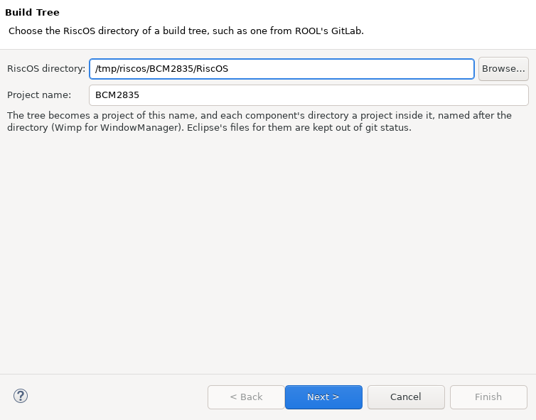

2. **Configurations.** Each `Env` file is a configuration: what the tree
   builds and for which machine, such as the ROM image for the Raspberry Pi
   (`ROOL/BCM2835`) or a disc image (`ROOL/Disc`). Tick the ones you want to work with; each takes
   some seconds to scan, so a few are quicker than all of them. Then choose
   the **Active configuration**: the one whose view of the sources you see
   (which code is shaded as not assembled, which macros C is compiled with).
   You can switch later.

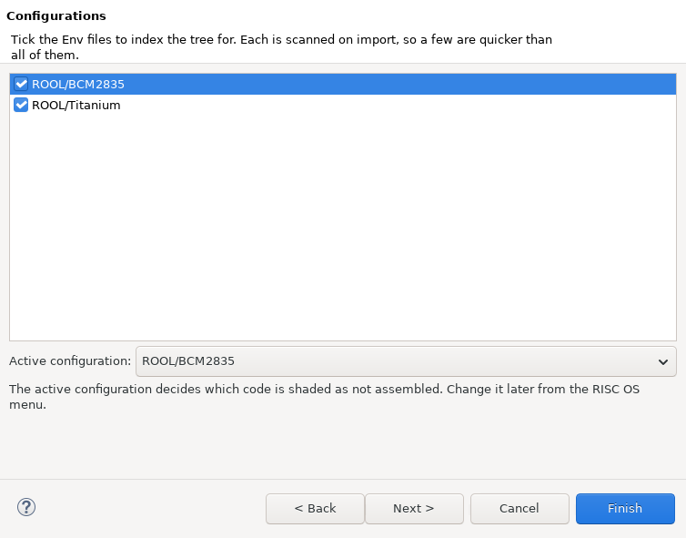
3. **Components.** The components that have code in the configurations you
   ticked. By default all are imported; untick any you don't want.

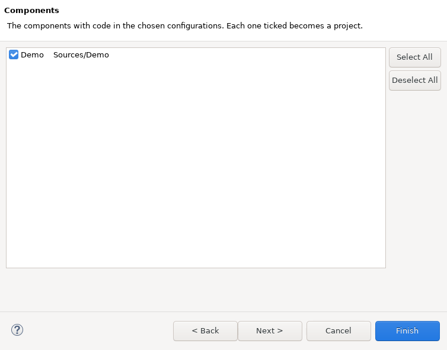
4. **External Projects** (optional). Directories *outside* the tree whose
   makefiles build against its exports, such as an application you're
   writing. Add each with the name of the component to build it as (make's
   `COMPONENT`). You can also add these later.

Click **Finish**. The import runs in the background (the progress is in the
bottom right corner), and so does the indexing that follows. For a whole
tree they take a while; you can carry on meanwhile.

What the import makes:

* **A project for the tree**, at its `RiscOS` directory, and **a project for
  each component's directory**, named as the directory is (`Wimp` for the
  WindowManager component). Components that share a directory share a
  project. Nothing is copied: the projects *are* the tree's directories.
* Eclipse's own files for each project (`.project`, `.cproject`, `.settings/`)
  are written into those directories. They are added to the git repository's
  local excludes (`.git/info/exclude`), so they don't show in `git status`.
* Every file is read as **Latin-1**, as RISC OS sources are.
* Problems running a component's makefile are listed as warnings in the
  **Problems** view (**Window › Show View › Problems**).

### Seeing the tree as a tree

The **Project Explorer** on the left lists the projects, each component's
inside its tree's, where it belongs in the tree. If you'd rather have every
project in one flat list, click the **⋮** (View Menu) button at the top of
the Project Explorer and choose **Projects Presentation › Flat** (and
**Hierarchical** to go back).

In an `objs/` directory the sources come first, assembler and C, then the
files the build makes from them.

Like a C file, an assembler or BASIC file opens out in the Project Explorer
into what its Outline shows, sorted as CDT sorts a C file's contents: by
kind (the files it `GET`s, `INCLUDE`s or `LNK`s, as a C file's `#include`s;
macros; `IMPORT`s; constants, fields and register names; variables; then
labels, `PROC`s and `FN`s), and by name within each kind. Double-click
one to open the file there. The file needn't be open,
though an assembler file's list waits for indexing to reach it.

### Link farm names

Each component's `objs/` directory holds links to its sources under the names
the assembler and compiler use: `objs/Wimp10.s` for `s/Wimp10`, `objs/main.c`
for `c/main`. Eclipse works with those names, as they say what each file is.
The real files' names are hidden from the Project Explorer, from searches and
from **Open Resource**, so that each file appears once. To see or use the
real names instead, see [Settings](#12-settings).

If something does open a file by its real name, the plugin closes that editor
and opens the link's name in its place.

## 5. Assembler

Open an assembler file by double-clicking it in the Project Explorer, or with
**Ctrl+Shift+R** (Open Resource) and its name. Files without an extension
that the assembler reads (exported headers such as `Hdr:Macros`) are
assembler files too.

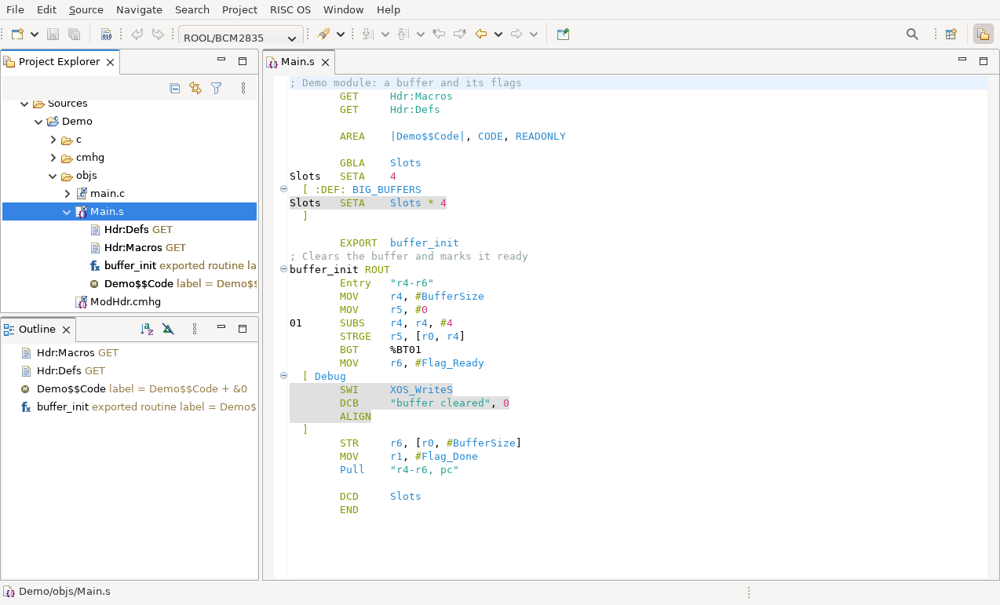

* **Colouring** of labels, directives, instructions, registers, numbers,
  strings and comments.
* **Shading.** Code that the active configuration doesn't assemble (the
  untaken side of `[ … | … ]`, `IF`, `WHILE`) is shaded grey. Code that
  *some* entry points assemble and others don't is not shaded.
* **Hover** (rest the mouse on a name):
  * a symbol: what it is (label, constant, register, field…), its value and
    where it's defined; where different entry points give it different
    values, each value;
  * a macro call: the macro's definition line; the lines the call **outputs**
    (instructions and data, with the macros it calls expanded too, after
    `$` substitution); then the expansion as written, with lines not
    assembled marked **✗**; and every symbol the call defines;
  * a line using a `$variable`: the line after substitution, each way it is
    assembled.

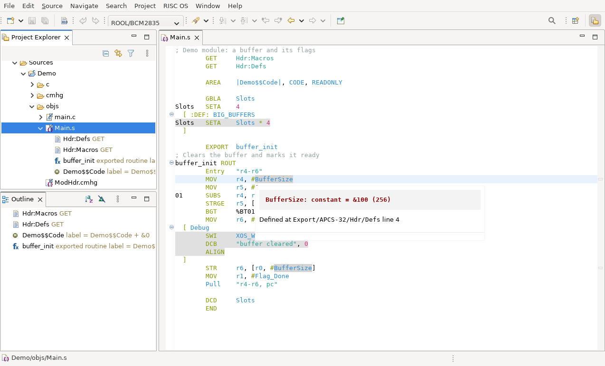

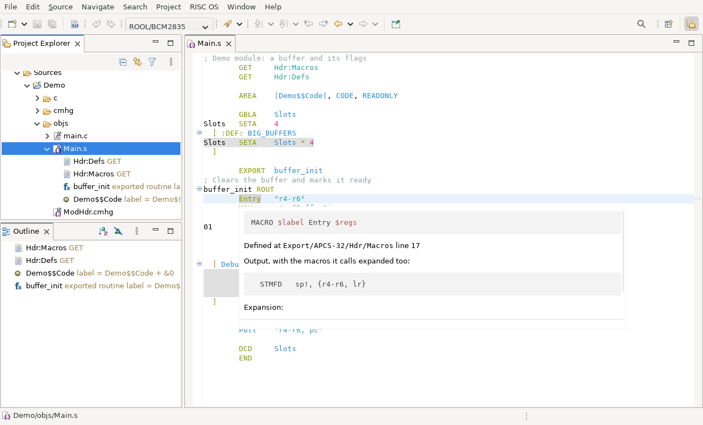
* **Go to definition**: **F3**, or hold **Ctrl** and click the name. Holding
  Ctrl and resting on a name lists every place it can go:
  * **Open Definition** for a label, constant or macro;
  * for a variable (`GBLA`, `LCLS`…): **Open Declaration** for its `GBLA`
    and **Open Assignment** for each `SETA`, `SETL` or `SETS`;
  * a `GET` or `INCLUDE` opens the file;
  * an `IMPORT`ed name goes to its definition: in another of the
    component's assembler files, in C, or in a library the component links
    with (see [C and C++](#8-c-and-c)).

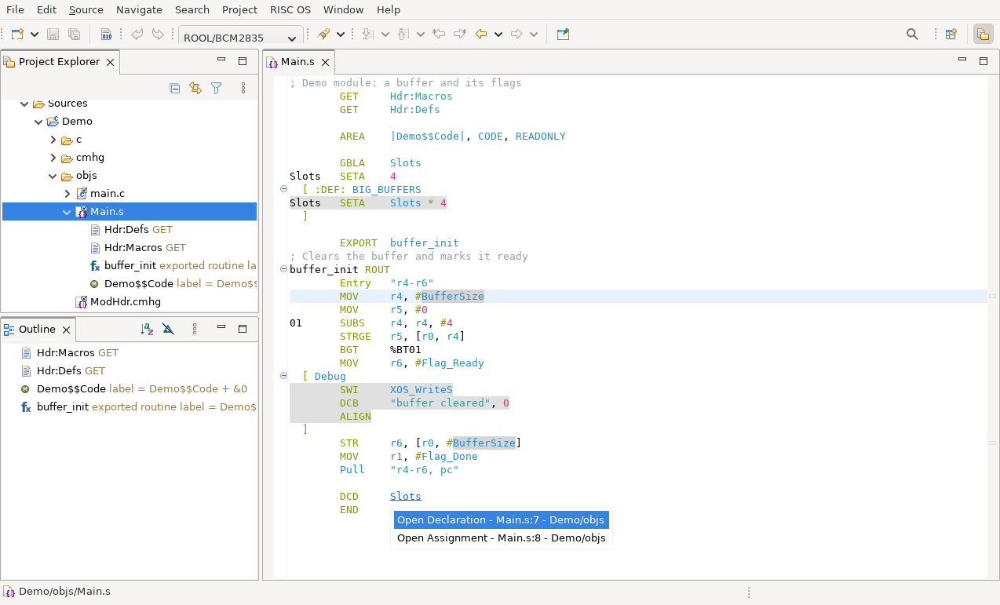

  **Alt+←** goes back.
* **Other uses highlighted**: with the cursor on a name, its other uses in
  the file are highlighted.
* **Find uses**: **Ctrl+Shift+G**, or right-click › **References**. The
  results appear in the **Search** view; double-click one to go there. Uses
  inside macro expansions are shown at the call.
* **Outline**: the **Outline** view (**Window › Show View › Outline**) lists
  the files it `GET`s, `INCLUDE`s or `LNK`s, and its labels, routines and
  macros, those it `EXPORT`s marked *exported*; **Ctrl+O** shows the same as a
  quick, searchable list. Click one to go there.
* **Folding**: the **–** and **+** in the left margin fold routines, macro
  definitions and each clause of a conditional.
* **Completion**: **Ctrl+Space** completes symbols, directives, instructions
  and macro names, local labels after `%`, and variables after `$`.
* **Problems**: what objasm would report (undefined symbols, wrong
  directives…) is underlined, and listed in the **Problems** view.
* **Go to Symbol in Workspace** finds a symbol anywhere in the tree by name:
  **Ctrl+Shift+T** in an assembler or BASIC editor (unless another plugin
  uses that key; Eclipse then asks which command you meant). It isn't in any
  menu, but you can also type the name into the **Quick Access** box
  (**Ctrl+3**, or the search box at the top right): symbols that match are
  listed under *Workspace Symbols*.

## 6. BBC BASIC

BASIC programs open with their own colouring and features, whether they are
text (`.bas`, `.bbc`, `,fd1`) or tokenised (`,ffb`). Each program is indexed on its
own.

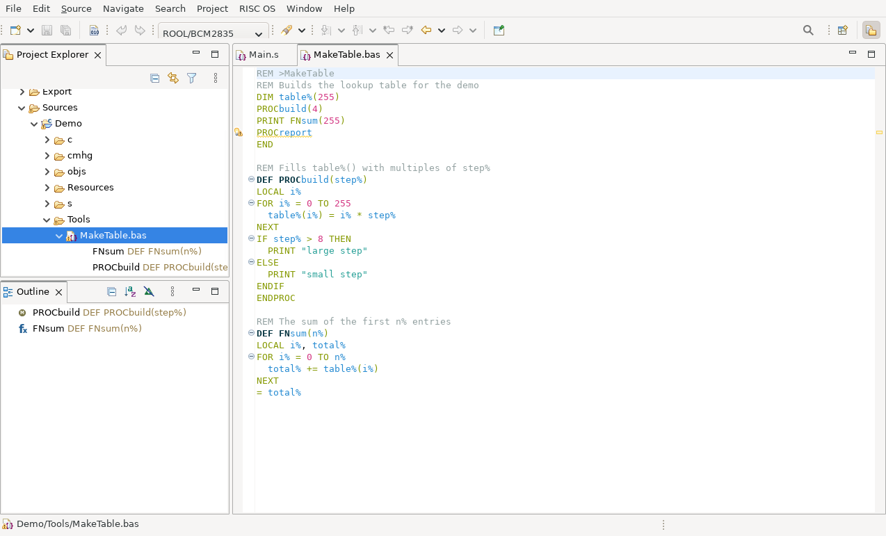

* **PROCs and FNs**: go to the `DEF` (**F3**, **Ctrl+click**), find uses
  (**Ctrl+Shift+G**), hover for the `DEF` line and the `REM` comment above it.
* **Variables** (`foo`, `foo%`, `foo$`, and arrays `foo(`…, each a different
  variable): **Ctrl** and rest on one to see **Open Declaration** for its
  `LOCAL`, routine parameter or `DIM`, and **Open Assignment** for each place
  it's given a value (`=`, `FOR`, `READ`, `INPUT`, `SWAP`, `SYS … TO`, or an
  element of an array). Hover says whether it's global or local, and where
  it's assigned.

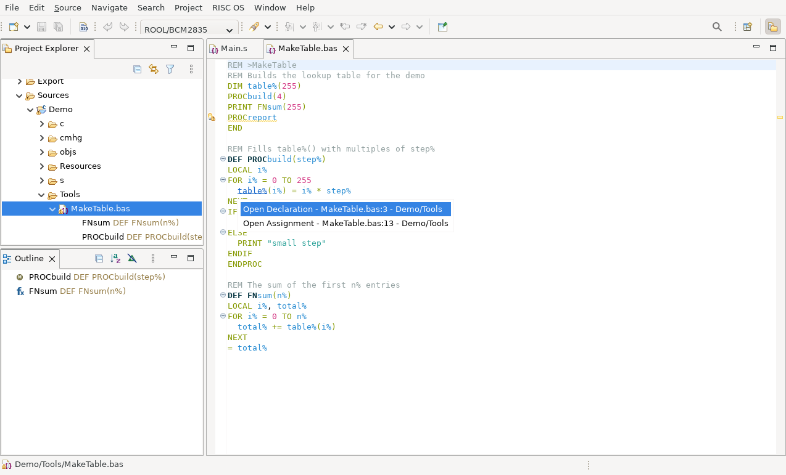
* **Line numbers** after `GOTO`, `GOSUB` and `RESTORE` go to their lines.
* **Outline**, **folding** (each routine, `IF` clause, `CASE` and loop) and
  **completion** after `PROC` and `FN`. With the cursor on a name, its other
  uses are highlighted.
* **SWI names**: inside the string after `SYS`, **Ctrl+Space** completes the
  name of any SWI in the build tree, showing its number. The names come from
  the `AddSWI` calls in the exported assembler headers and from the
  components' CMHG files, so they include SWIs that only a C module provides.
* **Problems** are underlined and listed in the **Problems** view:
  * a routine called but defined nowhere in the program; if a file beside it
    (the other parts of a program split over several files) or a library the
    program loads might define it, that is only information, shown if you
    ask for it (see [Settings](#12-settings));
  * a routine defined twice;
  * a `GOTO`, `GOSUB` or `RESTORE` to a line that doesn't exist;
  * blocks that don't match: an `ENDIF`, `NEXT`, `UNTIL`, `ENDWHILE`,
    `ENDCASE` or `ENDPROC` with nothing to close, or a block left open;
  * as information, a variable read but never assigned in the file.

### Tokenised programs

A tokenised program (`,ffb`) is shown and edited as text. When you save, it
is tokenised again:

* lines you haven't changed keep their line numbers;
* new lines are numbered between their neighbours; if there's no room, the
  program is renumbered, and you are told;
* line numbers are shown only if the program refers to them (`GOTO` and the
  like), as RISC OS's Edit does.

Spaces at the ends of lines are kept, except in lines you've changed, from
which they're removed unless you change that in [Settings](#12-settings).
Keep a copy of a program before you first save it, until you are happy with
the result.

To make a new program, choose **File › New › File** and give it a name
ending `,ffb`, such as `MyProg,ffb`. It opens empty, as text, and is saved
tokenised. (A name without `,ffb` gives a text file instead, which RISC OS
types as text: `,fd1` for BASIC text, or `.bas` here.)

## 7. Messages files

`Messages` files can contain NUL characters (byte 0), which matter and which
a text editor would lose. Such a file opens with each NUL shown as **␀**.

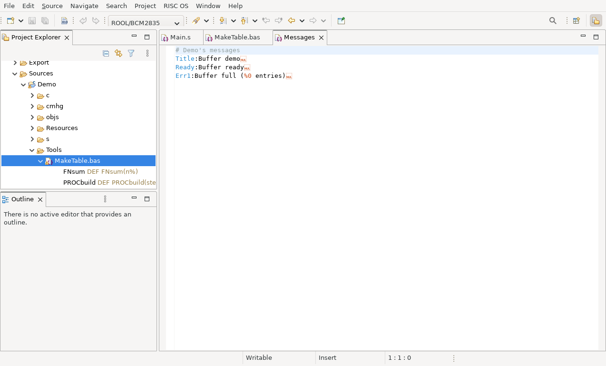

* Tokens, their text and `#` comments are coloured.
* **Ctrl+Alt+0**, or **RISC OS › Insert NUL (␀)**, types one.
* Saving writes each ␀ back as a NUL byte.
* A character that Latin-1 can't hold can't be saved; you are told which
  line it's on.

## 8. C and C++

With the C and C++ feature installed, each component with C files is a
C/C++ project, using Eclipse's C tools (CDT). Each file's **include paths and
macros come from the makefiles** for the active configuration, so `#if`
blocks are shaded as that configuration compiles them, and go to definition,
hover and completion work across the tree's exported headers.

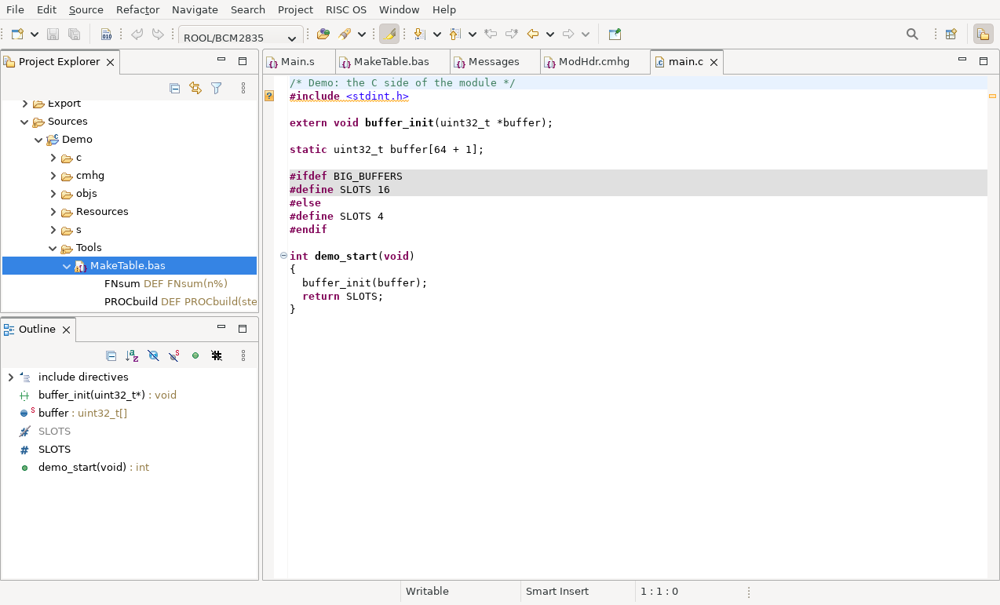

* **Indexing.** CDT indexes the C files in the background after the import;
  the progress is in the bottom right corner. A whole tree takes a while.
* **Where the settings are.** In a project's **Properties › C/C++ General ›
  Preprocessor Include Paths, Macros etc.**, on the **Entries** tab, under
  *RISC OS build tree*, select a file to see its include paths and macros.
  (The **Paths and Symbols** page shows only settings you add yourself.)

Between C and assembler, by name, as the linker joins them (looking in the
component and the libraries it links with):

* In assembler, **F3** on an `IMPORT`ed name goes to its C definition, and
  **Ctrl** and rest offers the C declaration in its header as well.
* **Find uses** of an `EXPORT`ed label includes the C files that call it.
* In a C file, **Ctrl** and rest on a function written in assembler offers
  **Open Assembler Definition**; the editor's right-click menu has that and
  **Find References in Assembler**.

## 9. Configurations, rescanning and other trees

The **RISC OS** menu:

* **Active Configuration ›** switches to another of the configurations you
  imported. Shading, hover values and C settings change to match; nothing
  needs restarting. The drop-down list on the toolbar shows the active
  configuration and switches it too (one list for each tree, if you've
  imported several).
* **Rescan Build Tree** runs the makefile scan again: after you change a
  makefile, a Components file or an Env file, or after pulling changes that
  do. Also run it after installing a new version of the plugin.
* **Add External Project…** adds a directory outside the tree that builds
  against its exports, as on the last page of the import.

**Several trees** can be imported into one workspace, each with its own
active configuration. Where a component's project name is already used by
another tree, the tree's name is added in brackets (`Wimp (BCM2835-2)`). The
menu's commands act on the tree of the file you're editing or have selected;
if that doesn't say which, they ask.

## 10. CMHG files

CMHG files (named `.cmhg`, as a component's `objs/` links name them: the
descriptions of a module's header that CMHG turns into assembler) are
coloured. There is nothing to navigate in them.

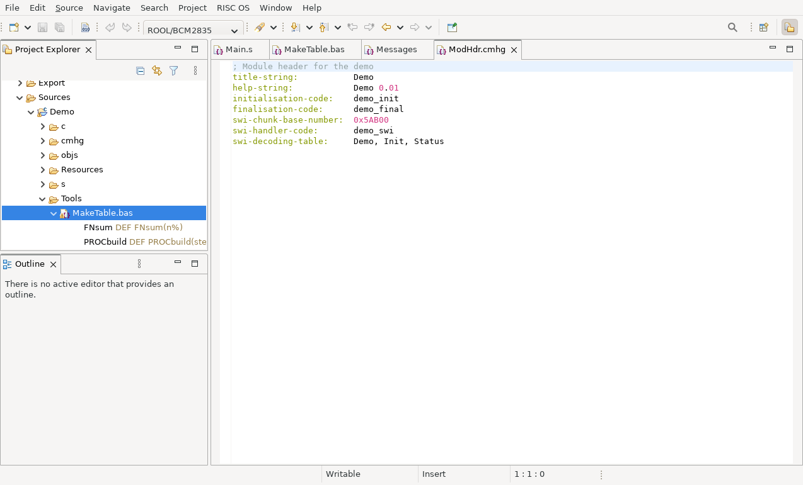

## 11. Searching

* **Ctrl+H** opens **Search**; the **File Search** tab searches the text of
  files. Each source is found once, by its `objs/` name.

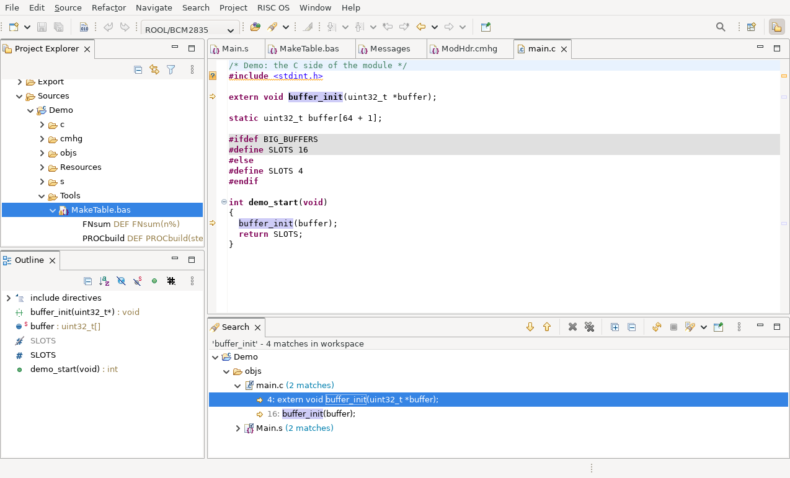

* **Ctrl+Shift+R** (Open Resource) opens a file by name.
* **Ctrl+Shift+G** finds the uses of the name at the cursor (assembler and
  BASIC); in C, CDT's own **References** does.

## 12. Settings

**Window › Preferences** (**Eclipse › Settings** on macOS), then **RISC OS**:

* **Show information diagnostics**: also underline things worth knowing that
  aren't problems: a macro hidden by an instruction of the same name, a
  routine that another file probably defines, a variable never assigned.
* **Files in `objs/` link farms have two names**: use the link names (the
  default); use the real files' names (`s/Wimp10`) instead; or use the link
  names but show the real files in the Project Explorer too. Restart Eclipse
  after changing this.
* **On saving a BASIC file** and **on saving an assembler file, remove spaces
  and tabs at the ends of lines**: leave them; remove them from the lines
  you've changed since the file was last saved (the default); or from all
  lines.
  Undo puts the spaces back. In BASIC, an unquoted `DATA` item keeps any spaces at
  its end, so be careful of removing them from a program that relies on that.

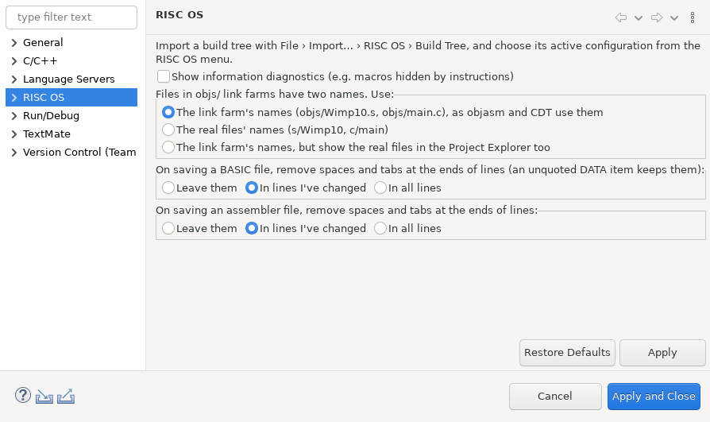

**RISC OS › Advanced** is for when something is wrong:

* the **settings directories**, one per tree, which the import fills in;
* the language server's **maximum heap** (blank for 1500m; raise it if a very
  large tree, or several, fail to index);
* the **Java command** and the **jar** to run it with (blank for the ones that
  come with Eclipse and the plugin).

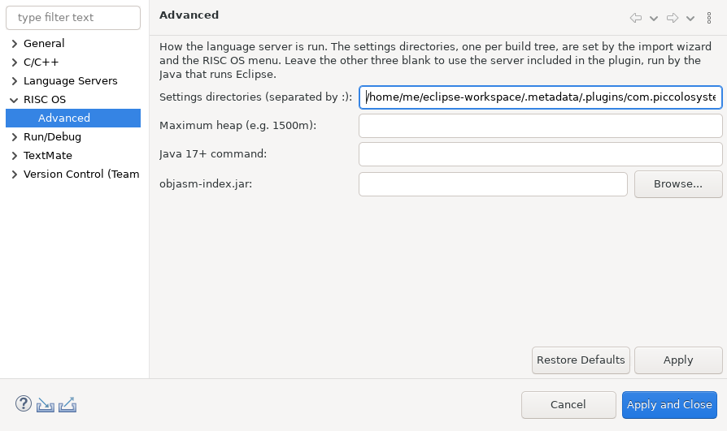

Other settings that matter here:

* The colour of the grey shading: **General › Editors › Text Editors ›
  Annotations**, *RISC OS: not assembled in this configuration*. *RISC OS:
  macro lines skipped in every expansion* is off by default; turn it on to see
  those too.
* What Eclipse does with a file it has no editor for: **General › Editors ›
  File Associations**, *Open unassociated files with*.

## 13. When things go wrong

* **Nothing is shaded and go to definition does nothing in assembler.** The
  indexer may still be working: look at the bottom right corner. If it has
  finished, run **RISC OS › Rescan Build Tree**. If that doesn't help, look at
  the indexer's log, `<workspace>/.metadata/.plugins/com.piccolosystems.riscos.lsp/objasm-index.log`.
* **C has no include paths or macros.** Run **Rescan Build Tree**; it sets
  the C projects up again. Check the *Entries* tab described in
  [C and C++](#8-c-and-c).
* **A file opens without colouring.** It may have been opened before with
  another editor, which Eclipse remembers: right-click it, **Open With ›
  RISC OS Text Editor**.
* **"You are editing a derived file".** You opened a file through the tree's
  project rather than its component's (or by its real name). Open it from the
  component's project instead.
* **A NUL shows as an empty box, not ␀.** The editor's font has no such
  character, and no other font on the system has. Install one that does
  (Symbola, DejaVu or Noto, for example), or choose another font under
  **General › Appearance › Colors and Fonts**, *Basic › Text Font*.
* **The language server's messages.** **Preferences › Language Servers ›
  Logs**: tick the RISC OS server's *Log to file*, and the messages are written
  under `<workspace>/.metadata/.plugins/org.eclipse.lsp4e/`.
* **Problems in the sources themselves.** Many warnings are real problems in
  the sources rather than in the plugin: the editor checks every assembler
  file the active configuration uses, and every BASIC program, including
  ones that are rarely built or run, such as test programs.
